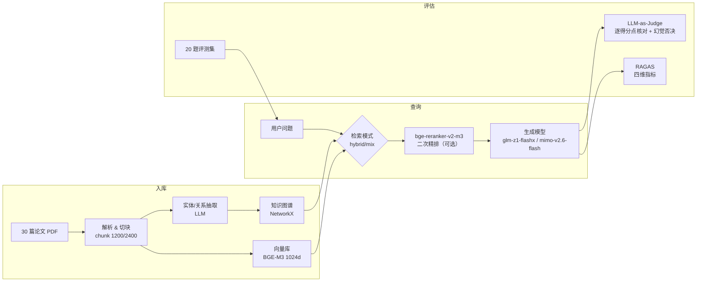

# PaperGraphRAG：学术论文知识图谱问答系统与评估体系

> 基于 LightRAG，面向 30 篇 AI 经典论文（Transformer / BERT / RAG / LoRA / RoPE / CoT 等）构建的图谱增强 RAG 问答系统。
> 项目重点不只是"搭起来"，而是建立了一套**可复现的评估闭环**：测试集设计 → LLM-as-Judge 逐点核对 + RAGAS 双轨评估 → 消融调优。

## 特性

- **图谱增强检索**：基于 LightRAG，实体/关系抽取 + 知识图谱构建，支持 naive / local / global / hybrid / mix 五种检索模式
- **端点集中配置**：LLM（小米 MiMo）、Embedding / Rerank（硅基流动）的端点与密钥统一收在 `my/.env`，脚本与评测工具均从环境变量读取，不硬编码
- **检索精排**：BGE-M3 嵌入（1024 维）+ bge-reranker-v2-m3 二次重排（rerank 消融数据见下文）
- **系统化评估**：
  - 20 题评测集，可答题逐条标注**结构化得分点（scoring_points）**、不可答题标注**通过线（pass_criteria）**
  - LLM-as-Judge 逐得分点核对（rubric 化）+ **幻觉一票否决**
  - RAGAS 四维指标（faithfulness / answer_relevancy / context_precision / context_recall）双轨交叉验证
- **一键服务化**：`my/serve_webui.py` 启动 FastAPI Server + WebUI，支持知识图谱可视化

## 架构



## 安装 / 依赖

```bash
# 1. 安装 Python 依赖（固定版本见 requirements.txt）
pip install -r requirements.txt

# 2. 准备端点与密钥：复制模板后填入各平台 Key
cp my/.env.example my/.env
```

`my/.env` 里需要填写的键（均为运行时读取，脚本内不硬编码）：

| 用途 | 键 |
| --- | --- |
| 生成/裁判 LLM（小米 MiMo） | `MIMO_API_KEY` / `MIMO_BASE_URL` / `MIMO_MODEL` |
| 嵌入与精排（硅基流动） | `SILICONFLOW_BASE_URL` / `SILICONFLOW_API_KEY` / `SILICONFLOW_EMBED_MODEL` / `EMBEDDING_DIM` / `RERANK_MODEL` |
| 备用生成模型（智谱 GLM） | `GLM_BASE_URL` / `GLM_API_KEY` / `GLM_MODEL` |

## 快速开始

```bash
# 0. 下载语料：按 arXiv ID 拉取 30 篇论文 PDF 到 my/corpus-ai-papers/
python download_corpus.py

# 1. 配置端点与密钥（MIMO_* / SILICONFLOW_* / GLM_*）
cp my/.env.example my/.env

# 2. 论文入库：解析 PDF → 切块 → 抽取实体关系 → 建图 + 向量化
python my/insert_eval_papers.py

# 3. 批量评测：逐题查询，记录答案与检索到的 chunks
python my/eval_baseline.py --rerank --name eval_mimo-v2.6-flash_rerank --outdir ./my/results1

# 4. LLM-as-Judge：逐得分点核对 + 幻觉一票否决
python my/eval_judge_v2.py eval_mimo-v2.6-flash_rerank --outdir ./my/results1

# 5. RAGAS 四维指标
python my/eval_ragas.py eval_mimo-v2.6-flash_rerank --outdir ./my/results1

# 6. 汇总各实验（默认读 my/results，当前实验在 my/results1，需指定 --outdir）
python my/eval_summary.py --outdir ./my/results1

# 7. 检索端内容级指标（实验二）：--kb 指向建该结果时所用的知识库目录
python my/eval_coverage.py --kb ./rag_eval_papers --outdir ./my/results1 \
    --names eval_mimo-v2.6-flash_norerank eval_mimo-v2.6-flash_rerank

# 8. 一键起服务
python my/serve_webui.py
```

> 所有命令均在**仓库根目录**执行；脚本内部使用 `./my/results`、`./my/testset_candidates_v1_1.json` 这类相对仓库根的路径，因此请勿改动 `my/` 这一层目录结构。

## 评测体系

**评测集**（`my/testset_candidates_v1_1.json`，当前锁定版）：20 题，覆盖 4 类、12 个主题。

| 题型   | 数量 | 考察点                 |
| ---- | -- | ------------------- |
| 事实直查 | 8  | 单篇论文的事实性问答          |
| 多跳综合 | 6  | 跨多篇论文的信息整合          |
| 比较   | 3  | 多方法横向对比             |
| 不可答  | 3  | 库外问题，正确行为 = 拒答（测幻觉） |

**为什么需要 closed-book 对照**：语料是 Transformer、BERT 这类经典论文，生成模型预训练时大概率"背过"。直接评估无法区分"检索起作用"还是"模型本来就会"。因此先让同一模型不挂知识库作答（closed-book），凡是闭卷就能全对的题目直接替换——评测集里多道题的 `meta.note` 记录了这次替换的来由（如原 Q15 被替换、原 Q7 换成 Self-RAG）。

**双轨评估（v2）**：17 道可答题共标注 **54 个得分点**、3 道不可答题各标注通过线。LLM-as-Judge 逐得分点核对命中（输出 hit/total 可复查），替代整体印象打分；另有**幻觉一票否决**：回答与标准答案矛盾、或虚构实体/文献，无论命中多少得分点均判不通过。RAGAS 同步输出 faithfulness / answer_relevancy / context_precision / context_recall 四维指标，两套结果交叉验证。

> 换 chunk 尺寸重建库后，golden chunk 索引会全部失效，配套评测集需按正文内容重新映射——2400 档使用 `my/testset_candidates_2400.json`。

## 实验结果

### 实验一：rerank 消融 × 生成模型对比（hybrid 模式，同一知识库 chunk 1200，2026-10 复测）

reranker 为 bge-reranker-v2-m3。用**两款推理型 LLM（glm-z1-flashx / mimo-v2.6-flash）**各做一组消融。得分点命中率 = 全部可答题命中得分点总数 / 54，通过率 = 通过题数 / 20：

| 生成模型 | rerank | 得分点命中率 | 通过率 | 幻觉否决 | faithfulness | context_precision | context_recall |
|---|---|---|---|---|---|---|---|
| glm-z1-flashx | ✗ | 77.8% | 60% | 2 | 0.772 | 0.586 | 0.843 |
| glm-z1-flashx | ✓ | **85.2%** | 55% | **5** | **0.893** | **0.813 (+22.7pp)** | **0.926** |
| mimo-v2.6-flash | ✗ | 98.1% | 85% | 2 | 0.926 | 0.630 | 0.971 |
| mimo-v2.6-flash | ✓ | **100.0%** | 85% | 2 | 0.947 | **0.823 (+19.3pp)** | **0.984** |

三个结论：

1. **rerank 的检索侧增益第三次稳定复现**：context_precision +19.3~22.7pp，mimo 下 context_recall 达 0.984。
2. **推理能力 ≠ 上下文忠实度**：两款同为推理型的模型，grounded QA 表现悬殊（得分点命中率 98.1% vs 77.8%，通过率 85% vs 60%）。glm-z1 的失分主因是幻觉与"过度作答"——两道库外不可答题均被其长篇编造，mimo 则正确拒答。
3. **检索优化能否兑现为答案质量因模型而异**：glm-z1 在 rerank 后得分点命中率 +7.4pp、faithfulness +12.1pp，但幻觉否决从 2 增至 5（多道题得分点全中却因"画蛇添足"的细节错误被否决），通过率反降。**RAG 生成端选型必须用评测集实测 groundedness，不能凭模型定位或通用 benchmark 印象决策。**

### 实验二：chunk size 1200 vs 2400（检索端，查询模型 mimo-v2.6-flash）

用**内容级**指标（golden 正文 200 字滑窗覆盖率）替代"命中几个 golden chunk"，以消除切块尺寸对命中统计口径的扭曲；口径定义与复现脚本见 `my/eval_coverage.py`（win=200 / stride=100，窗口完整出现在该题任一检索到的 chunk 正文中即算覆盖）：

| chunk size | 检索配置 | 平均检索 chunk 数 | golden 命中率 | golden 正文覆盖率 |
| ---------- | -------- | ------------ | ---------- | ------------ |
| 1200       | hybrid            | 12.65 | 87.9%  | **87.4%** |
| 1200       | hybrid + rerank   | 12.60 | 100.0% | **98.0%** |
| 2400       | hybrid            | 6.40  | 71.9%  | **80.6%** |
| 2400       | hybrid + rerank   | 6.45  | 90.6%  | **92.1%** |

**结论**：

1. **同配置下 1200 的正文字段覆盖率更高**（无 rerank 87.4% vs 80.6%；rerank 98.0% vs 92.1%）。原因是 1200 平均召回约 2 倍数量的 chunk（12.65 vs 6.40），golden 正文被切得更碎、更易被整体召回；2400 把 golden 合并成更少的大块，任一漏召回都会明显拉低条目级命中率（71.9% vs 87.9%）。
2. **rerank 能补偿 2400 的召回劣势**：精排对两种切块都显著拉升覆盖率（1200 +10.6pp，2400 +11.5pp），并把 2400 拉到 92.1%，与 1200 rerank 的差距缩小到 5.9pp。
3. 但 chunk 数减半**不等于**上下文减半：两种切块实际检索到的正文总量几乎相同（平均各约 5.6 万字符，即 ~6 段完整文本 ≈ ~13 段碎块的长度），均未触及 30k token 上限。2400 的真实价值是**抗碎片化**——相同文本量下块边界更少、语义更连贯，这与逐题观察一致（多跳综合题偏向 2400，事实直查题偏向 1200）。

## 目录结构

```
PaperGraphRAG/
├── README.md
├── LICENSE                 # MIT
├── .gitignore
├── requirements.txt        # 固定版本的依赖清单
├── download_corpus.py      # 按 arXiv ID 下载 30 篇论文 PDF 到 my/corpus-ai-papers/
└── my/                     # 作者产出的评测代码与数据（脚本内用 ./my/... 相对仓库根的路径）
    ├── serve_webui.py          # 一键启动 FastAPI Server + WebUI（读 my/.env，内置 rerank 适配）
    ├── insert_eval_papers.py   # 批量论文入库（chunk 尺寸 / 并发 / gleaning 可配）
    ├── eval_baseline.py        # 批量评测：逐题查询，记录答案 + 检索到的 chunks（内置独立实验缓存）
    ├── eval_judge_v2.py        # LLM-as-Judge v2：逐得分点核对 + 幻觉一票否决
    ├── eval_summary.py         # 汇总：通过率 / 得分点命中率 / 不可答通过率 / 幻觉否决数
    ├── eval_coverage.py        # 实验二检索端内容级指标：平均 chunk 数 / golden 命中率 / 正文覆盖率
    ├── eval_ragas.py           # RAGAS 四维指标
    ├── ragas_config.py         # RAGAS 裁判 LLM（MiMo）+ 裁判 Embedding（BGE-M3）配置
    ├── .env.example            # 端点与密钥模板（真实的 my/.env 不入库）
    ├── testset_candidates_v1_1.json   # 评测集 v1.1（当前锁定版）：20 题，含 scoring_points / pass_criteria
    ├── testset_candidates_2400.json   # 2400 档配套评测集（golden chunk 按库重建）
    ├── testset_closedbook.json        # closed-book 对照用评测集
    ├── results1/               # 当前实验数据（chunk 1200，4 组：模型 × rerank）
    │   └── eval_<模型>_<rerank>.{json, judged.json, ragas.json, ragas.per_question.json}
    └── results/                # 2400 档实验（chunk 2400，mimo × rerank）
        └── eval_mimo-v2.6-flash_{rerank, norerank}_2400.{json, judged.json}
```

> 运行时按需生成、不入库的内容：`my/.env`（真实密钥，由 `.env.example` 复制填写）、`my/corpus-ai-papers/`（由 `python download_corpus.py` 下载）、`rag_eval_papers*/`（LightRAG 知识库/向量库目录，可重建）。

**实验数据四件套**：每个实验名对应四份产物——`<实验名>.json`（答案 + 检索内容）、`<实验名>.judged.json`（逐题判定）、`<实验名>.ragas.json`（四维指标汇总）、`<实验名>.ragas.per_question.json`（四维指标逐题）。


## 在线演示

```bash
python my/serve_webui.py        # 启动服务（读 my/.env）
# WebUI:   http://localhost:9621/webui
# API 文档: http://localhost:9621/docs
```

## 踩坑记录

- `bge-m3` 输出固定 1024 维，不支持 OpenAI `dimensions` 参数，传了会直接报错（`serve_webui.py` 里显式设 `EMBEDDING_SEND_DIM=false`）
- **LLM 答案缓存会污染评测**：答案缓存键不含模型名，换生成模型后评测会重放旧答案。解决办法是每个实验用独立的缓存实例（`eval_baseline.py` 内置 `llm_response_cache_eval_<实验名>`），实验之间互不串扰
- 换 chunk 尺寸重建库后，原 golden chunk 索引全部失效，需按正文内容重映射（2400 档评测集的 `source` 就是这样重建的）
- 入库失败要可重试：30 篇论文入库总有零星失败（限流/超时），需记录 doc_status 后定点重试，而不是全量重来
- **平台风控驳回会被当成正常回答并写入缓存**：个别题（如 RoPE 原理）曾触发网关风控，返回 `The request was rejected because it was considered high risk`，但 `status` 仍记为 success，且该文本被写进答案缓存、直接重跑会重放。需先删掉对应缓存条目（`llm_response_cache_eval_<实验名>` 里的 `hybrid:query:<hash>`）再 `--only` 重跑。

## 致谢 / 许可

- 本项目基于 **[LightRAG](https://github.com/HKUDS/LightRAG)**（MIT License）构建，图谱构建、检索与服务化均复用其核心能力，特此致谢。
- 本仓库（PaperGraphRAG）**只包含作者自己产出的评测代码与实验数据**，以 MIT License 发布，详见 [LICENSE](LICENSE)。
- 语料为公开的 arXiv 论文，版权归原作者所有；本仓库不收录 PDF，请通过 `download_corpus.py` 自行下载并遵守 arXiv 的使用条款。